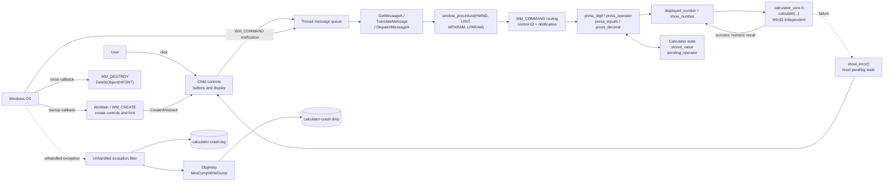
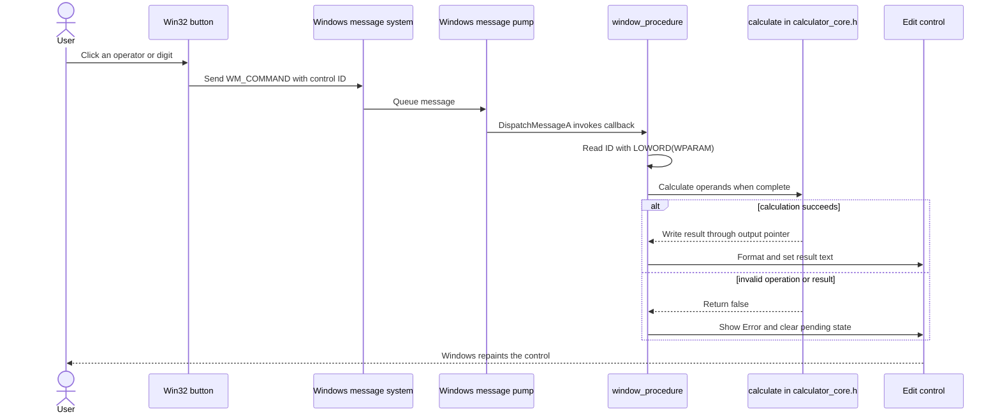

# C Calculator Architecture

This diagram shows the Win32 GUI, the shared arithmetic core, and the diagnostic paths. The implementation is procedural C: `WNDCLASSA` describes a window type, and Windows calls a registered callback; these are not user-defined C++ classes.

## Button-click sequence

`calculator_core.h` is deliberately separate so both the GUI and `tests/test_calculator.c` compile and execute the same arithmetic function. The GUI test is headless and does not initialize Win32 windows. The crash filter writes a minidump and a text record on unexpected process exceptions; it is diagnostic output, not application recovery.
